# Catálogo de telas e navegação

Levantamento das telas do SafeMask em 11/11/2026 (trazido do PI-III, CAMPUSCEUB/SafeMask#9): o que cada uma faz, quem a usa, o que chama na API e como se chega a ela. As capturas foram feitas num ambiente descartável (o mesmo do teste de interface: banco e pasta temporários, contas fictícias), em 1366 px de largura, e ficam em [`documentation/telas/`](telas/).

`backend/tests/test_catalogo_telas.py` confere que toda tela HTML do repositório está neste catálogo e que cada captura citada existe.

## Telas

| # | Tela | Arquivo | Quem usa | Para que serve | Rotas da API |
| --- | --- | --- | --- | --- | --- |
| 1 | Início | `index.html` | qualquer pessoa | Apresenta o produto e leva ao login e ao cadastro | — |
| 2 | Login | `frontend/html/auth/login.html` | qualquer pessoa | Entrar; depois de várias senhas erradas, avisa do bloqueio | `POST /auth/login` |
| 3 | Cadastro | `frontend/html/auth/cadastro.html` | qualquer pessoa | Criar conta | `POST /auth/cadastro` |
| 4 | Esqueci a senha | `frontend/html/auth/esqueci_senha.html` | qualquer pessoa | Pedir o e-mail de recuperação | `POST /auth/recuperar-senha` |
| 5 | Redefinir senha | `frontend/html/auth/reset_password.html` | quem recebeu o e-mail | Trocar a senha com o link recebido | `POST /auth/reset-senha` |
| 6 | Dashboard | `frontend/html/dashboard.html` | todos os usuários | Mapa geral, equipes, documentos recentes e o painel de conformidade | `GET /dashboard/overview`, `GET /dashboard/conformidade` |
| 7 | Novo Upload | `frontend/html/documentos/censurar.html` | membro, supervisor e líder | Escolher o PDF, revisar as tarjas antes de salvar, escolher equipes, título e nível | `POST /documentos/analisar`, `POST /documentos/upload` |
| 8 | Documentos Censurados | `frontend/html/documentos/censurados.html` | membros das equipes | Lista e detalhes dos documentos, versão com tarja, comprovante, exclusão (líder) | `GET /documentos/censurados`, `GET /documentos/censurados/{id}`, `.../arquivo`, `GET /documentos/{id}/comprovante`, `DELETE /documentos/{id}` |
| 9 | Descensura | `frontend/html/documentos/descensura.html` | membros, conforme cargo e nível do documento | Baixar a versão parcial ou o original | `GET /documentos/censurados/{id}`, `GET /documentos/{id}/parcial` |
| 10 | Gerenciar Equipes | `frontend/html/equipes/equipes.html` | supervisor e líder | Ver as equipes e criar uma nova | `GET /equipes/overview`, `GET /equipes/form-data`, `POST /equipes` |
| 11 | Página da equipe | `frontend/html/equipes/detalhe.html` | membros da equipe | Membros, cargos, documentos e política de níveis; o líder adiciona, remove e muda cargos | `GET /equipes/{id}`, `POST/DELETE/PATCH .../membros`, `GET/PUT .../politica-niveis` |
| 12 | Histórico de auditoria | `frontend/html/auditoria/historico.html` | supervisor e líder | Consultar e exportar a trilha da equipe | `GET /auditoria`, `GET /auditoria/exportar` |

O menu lateral e o topo de cada tela interna vêm de `frontend/js/app-shell.js`, que mostra cada item conforme o cargo (`membro`, `supervisor`, `lider`).

## Capturas

| Tela | Captura |
| --- | --- |
| 1 Início | 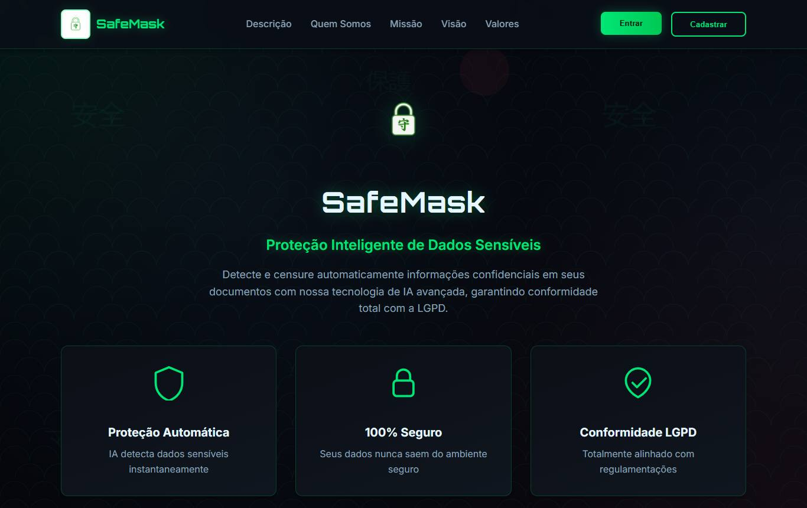 |
| 2 Login | 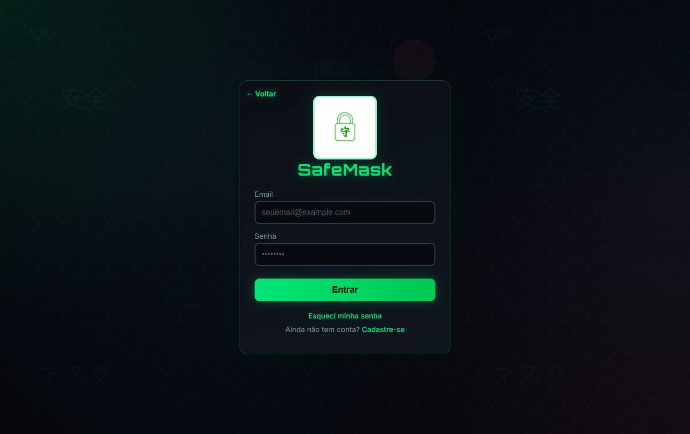 |
| 3 Cadastro | 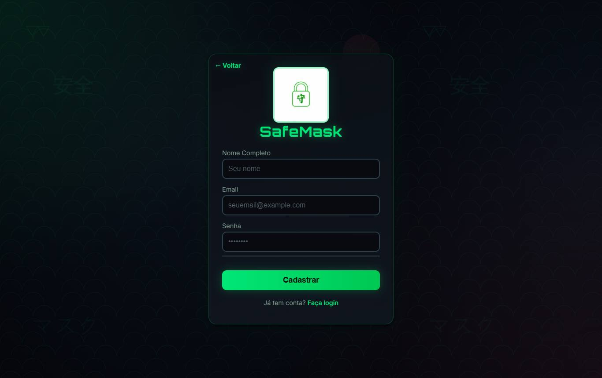 |
| 4 Esqueci a senha | 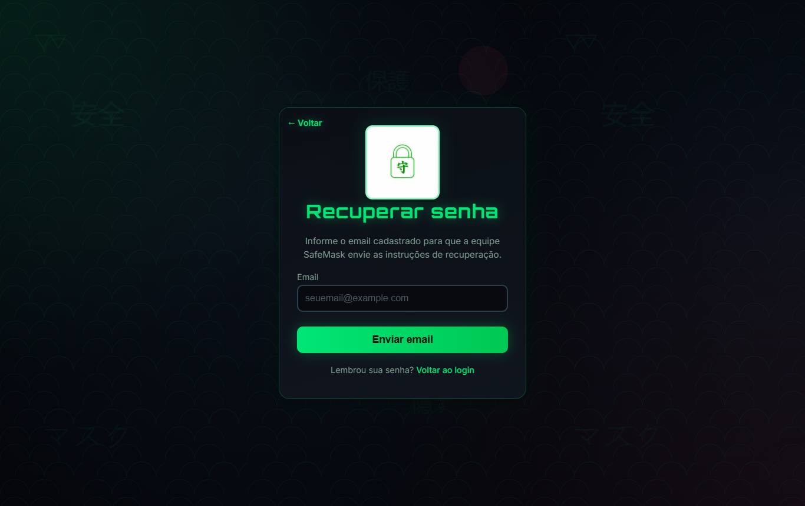 |
| 5 Redefinir senha | 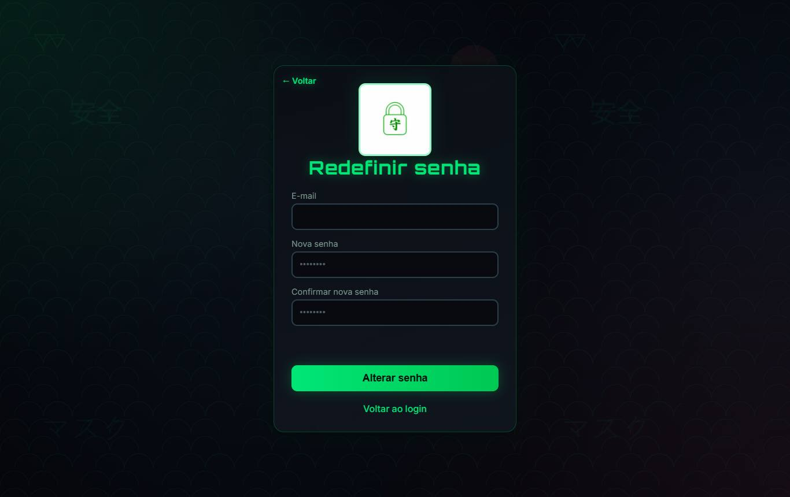 |
| 6 Dashboard | 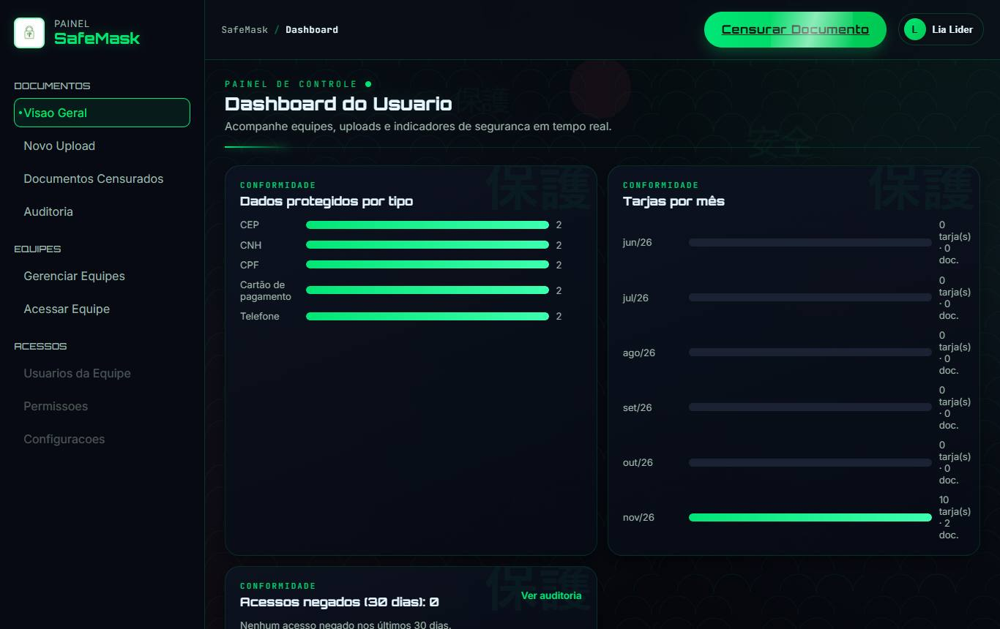 |
| 7 Novo Upload | 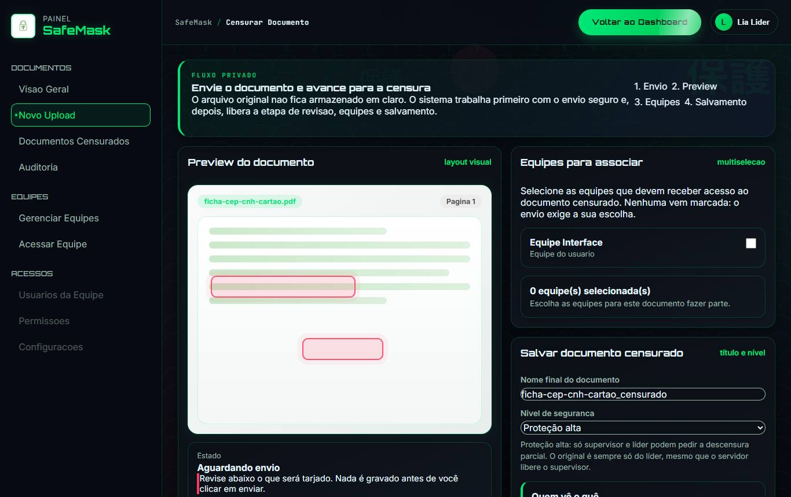 |
| 8 Documentos Censurados | 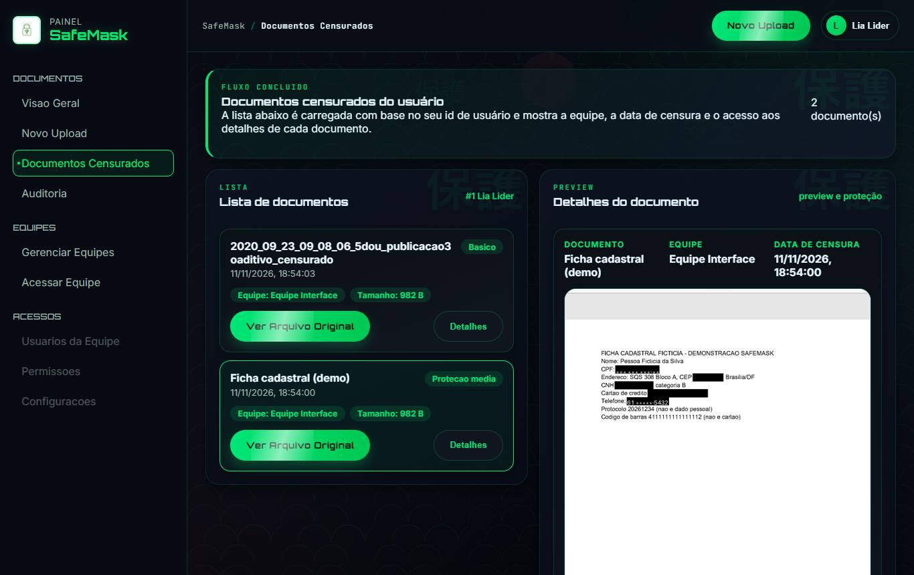 |
| 9 Descensura | 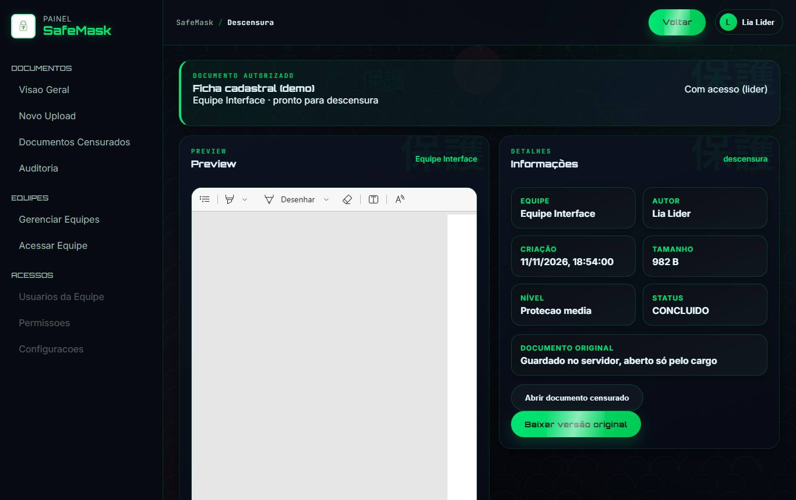 |
| 10 Gerenciar Equipes | 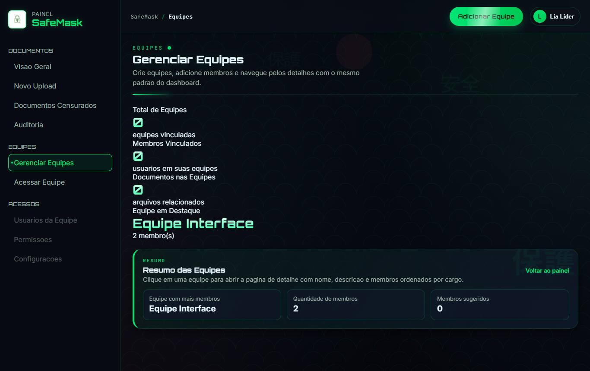 |
| 11 Página da equipe | 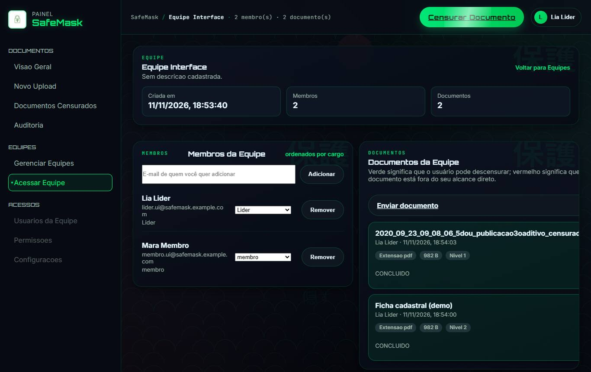 |
| 12 Histórico de auditoria | 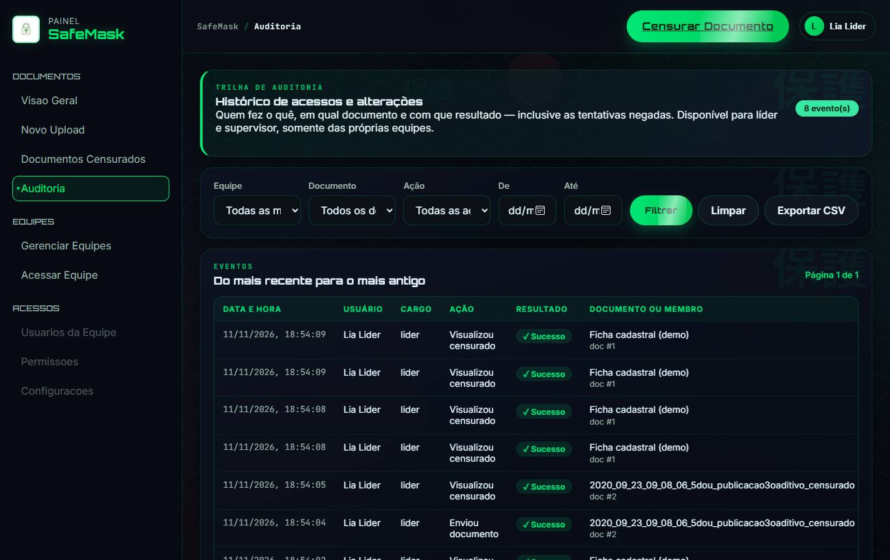 |

## Navegação principal

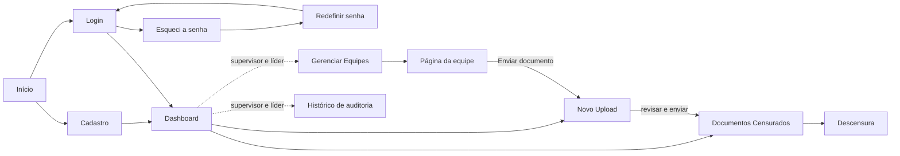

O fluxo principal, coberto pelo teste de interface (`backend/tests_interface/`), é: **Login → Novo Upload → revisão das tarjas → Documentos Censurados → Descensura**, com a Página da equipe para gerenciar quem vê o quê.

## Observações do levantamento

- **Itens do menu sem tela:** "Usuarios da Equipe", "Permissoes" e "Configuracoes" aparecem no menu (`app-shell.js`, `href: null`) e não abrem nada.
- **Links quebrados no Dashboard:** "Ver todos" aponta para `documentos/index.html`, que não existe, e "Abrir historico" aponta para `#`.
- As telas internas exigem o token do login; sem ele, voltam para o Login.
